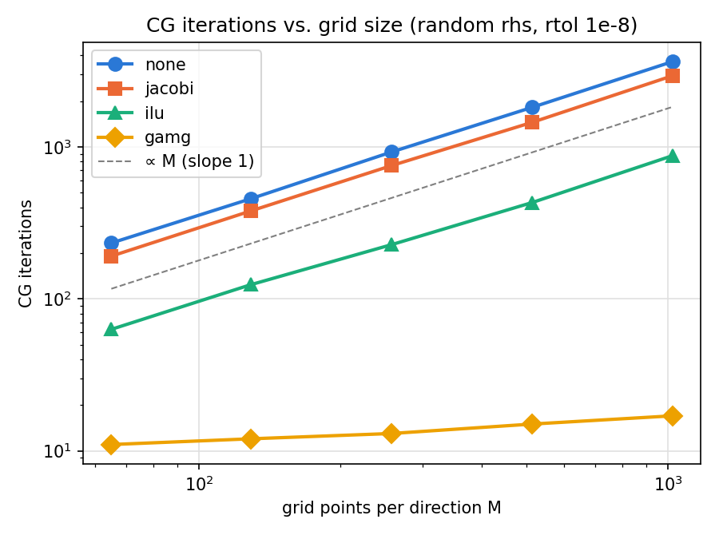
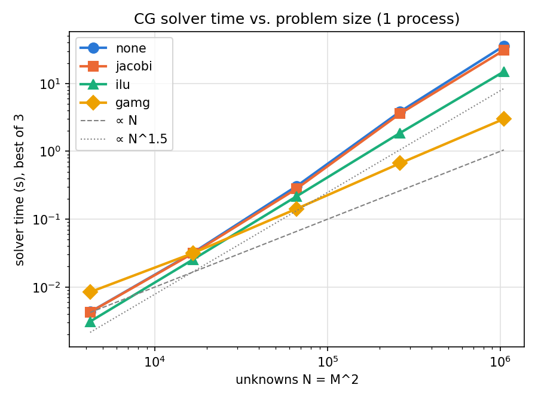

# Parallel 2D Poisson solver with PETSc 

PETScHPC solves a Poisson equation $-\Delta u = f$ on $\Omega = (0, 1)^2$ with boundary condition $u = 0$ on $\partial\Omega$
by 5-point stencil central difference method.
It is a C++17 code that uses PETSc for the distributed grid (DMDA), sparse matrix assembly and Krylov solvers (KSP).
The solver is verified with a manufactured solution and the error drops by a 
factor of 4.00 each time mesh size $h$ is halved $(O(h^2))$.
The solver runs in parallel with MPI plus PETSc DMDA domain decomposition, and the 
results show identical error ($5.02e-5$ at $129 \times 129$) on 1 and 4 processes.

## Problem and method

### Problem and the manufactured solution
- $-\Delta u = f \quad \text{ in } \Omega = (0, 1)^2, \qquad u = 0 \text{ on } \partial\Omega$
with $f = 2 \pi^2 \sin(\pi x) \sin(\pi y).$
- The manufactured (exact) solution is $u = \sin(\pi x) \sin(\pi y)$,
the manufactured solution vanishes on the boundary, which fits the boundary condition exactly.

### Discretization
- The mesh/grid: $M \times M$ points including the boundary with mesh size $h = 1/ (M - 1)$.
- 5-point stencil scheme
$-\frac{u_{i+1, j} - 2u_{i,j} + u_{i-1, j} + u_{i, j+1} - 2u_{i,j} + u_{i, j-1}}{h^2} = f_{i, j} $

### Boundary condition treatment
- All points on the boundary, i.e., $i = 0$, or $i = M - 1$, $j = 0$, or $j = M - 1$, are given an identity row (1 on the diagonal, right-hand side 0), which enforces $u_{i, j} = 0$ (Dirichlet BC).
- For interior points that have a boundary point as a neighbor, the boundary neighbor's entry is left out of the row, so the row has fewer than 5 entries. The neighbor's value is known to be 0, so its term in the stencil is 0.
- The boundary columns are left out of the interior rows, so the matrix $A$ to solve the final linear system $Ax = b$ is SPD (symmetric positive definite). This allows us to use Conjugate Gradient (CG) method, `-ksp_type cg`, which is the natural Krylov solver for SPD systems.

### Parallel implementation
- PETSc DMDA splits the mesh into blocks, one per MPI process, and each process assembles only the rows it owns.
- Rows and columns are set with mesh indices (`MatSetValuesStencil`).
- Solved with Krylov linear solver (KSP), with the solver and preconditioner chosen at the run time (`-ksp_type`, `-pc_type`).

## Build
- PETSc 3.26.0 built with MPI (e.g. configured with `--download-mpich`)
- CMake >= 3.20
- A C++17 compiler
- `pkg-config`

```bash
git clone https://github.com/hjdong2/PETScHPC.git
cd PETScHPC
export PETSC_DIR=/path/to/petsc        # where PETSc is installed
export PETSC_ARCH=arch-linux-c-debug   # which PETSc build to use (yours may differ)
cmake -S . -B build                    # config: find PETSc, generate build files in build/
cmake --build build                    # compile and link the executables
```
This builds `build/poisson` (the solver) and two small learning examples (`build/hello` and `build/dmda`).

## Run
```bash
mpiexec -n 4 ./build/poisson -M 129 -ksp_type cg -ksp_rtol 1e-12
```
It means run a 129 $\times$ 129 grid using 4 processes with Conjugate Gradient (CG) method, and a tight tolerance (`-ksp_rtol 1e-12`).
The expected output should be
```
M= 129, h = 0.0078125, err= 5.02009e-05, its= 157, reason= CONVERGED_RTO
```
- If you get the same error, your build works correctly.
- `error` is the maximum norm difference between 
the computed and the exact solution.

## Results
```bash
for M in 5 9 17 33 65 129; do
  mpiexec -n 1 ./build/poisson -M $M -ksp_type cg -ksp_rtol 1e-12
done
```
The results are generated using above command, run 1 process, and change $M$ from 5 to 129.
**Convergence result**:

| M | h | err | ratio |
|---|---|---|---|
| 5 | 0.25 | 5.303e-2 | — |
| 9 | 0.125 | 1.295e-2 | 4.095 |
| 17 | 0.0625 | 3.219e-3 | 4.023 |
| 33 | 0.03125 | 8.036e-4 | 4.006 |
| 65 | 0.015625 | 2.008e-4 | 4.001 |
| 129 | 0.0078125 | 5.020e-5 | 4.000 |
- the ratio (error previous M / error current M) is 4, shows the method is second-order ($O(h^2)$)
- `-n 1` and `-n 4` give the same error ($5.02009e-05$ at $M = 129$)

## Solver comparison
CG with 4 preconditioners (none, Jacobi, ILU, GAMG), random right-hand side, `-ksp_rtol 1e-8`, 1 process, M from 65 to 1025, 
optimized PETSc build, best of 3 runs.

```bash
./scripts/run_week4.sh | tee results/week4.csv
python3 scripts/plot_week4.py
```
Iterations: none/Jacobi/ILU grow $\propto M$; GAMG stays almost constant



Time: none/Jacobi/ILU grow $\propto N^{1.5}$; GAMG grows $\propto N$



At $M = 1025$ (about $10^6 unknowns$): 
| Preconditioner | Iterations | Time (s) | Speedup vs. none |
|---|---|---|---|
| none   | 3647 | 35.66 | 1.0x |
| Jacobi | 2944 | 30.76 | 1.2x |
| ILU    | 877  | 14.94 | 2.4x |
| GAMG   | 17  | 2.99 | 11.9x |
Laptop timings (Intel Core Ultra 7 155U); indicative only.


